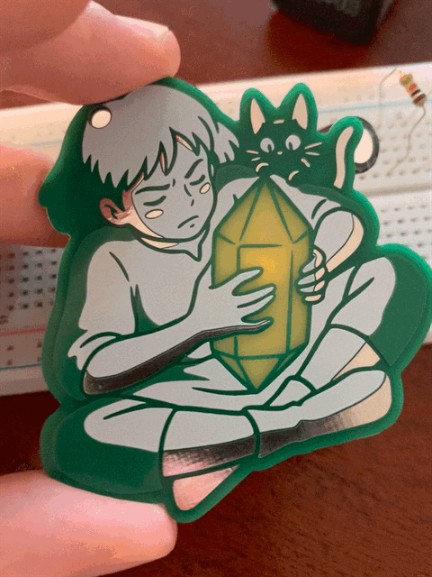

🇩🇪 Deutsch | 🇬🇧 [English](README.md)

# Lumina RC Fader

Mit dem Lötbausatz **„Lumina RC Fader"** entsteht an dieser Stelle eine Lernplattform, die Wissensvermittlung im Bereich der Elektrotechnik mit Storytelling-Elementen vereint.

Lumina RC Fader ist der zweite von drei aufeinander aufbauenden Lötbausätzen. Die Platinen erzählen die Geschichte der Zaubereischülerin Lumina, die lernt, magische Kristalle zum Leben zu erwecken. Luminas Lernprozess, der sie über Versuch und Irrtum bis hin zur Beherrschung der Magie führt, spiegelt sich wider im Lernen der Schüler\*innen, die mit Lötkolben und -zinn erste Erfahrungen im Bereich der Elektrotechnik machen.

## Status

Der Lötbausatz befindet sich in der Alpha-Phase.

## Lizenz

© 2026 Alexander Schmitz

Dieses Werk steht unter der Lizenz [Creative Commons Namensnennung – Nicht kommerziell – Weitergabe unter gleichen Bedingungen 4.0 International (CC BY-NC-SA 4.0)](https://creativecommons.org/licenses/by-nc-sa/4.0/deed.de).
