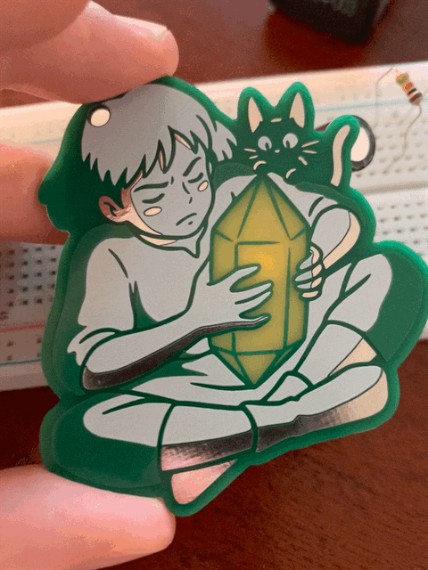

🇬🇧 English | 🇩🇪 [Deutsch](README.de.md)

# Lumina RC Fader

The solder kit **"Lumina RC Fader"** is the beginning of a learning platform that combines teaching electrical engineering with storytelling elements.

Lumina RC Fader is the second of three solder kits that build on one another. The boards tell the story of Lumina, a sorcery student who learns to bring magical crystals to life. Lumina's learning process, which takes her through trial and error to mastery of magic, mirrors the learning of students who gain their first experience in electrical engineering with a soldering iron and solder.

## Status

The solder kit is in its alpha phase.

## License

© 2026 Alexander Schmitz

This work is licensed under a [Creative Commons Attribution-NonCommercial-ShareAlike 4.0 International License (CC BY-NC-SA 4.0)](https://creativecommons.org/licenses/by-nc-sa/4.0/).
